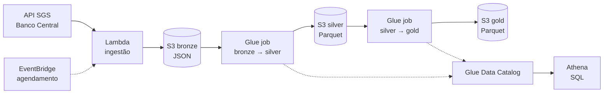
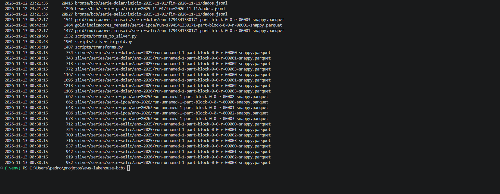
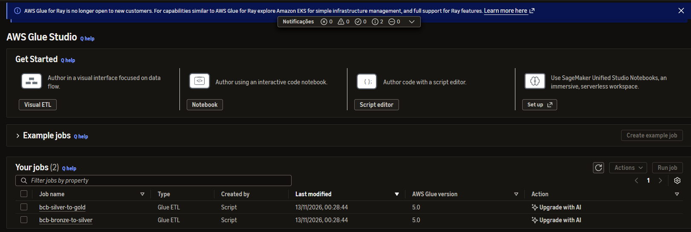
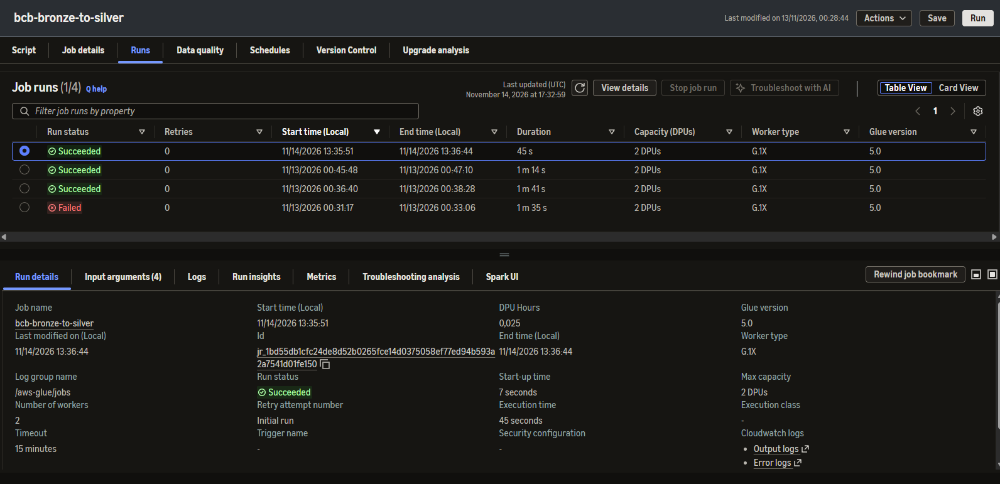
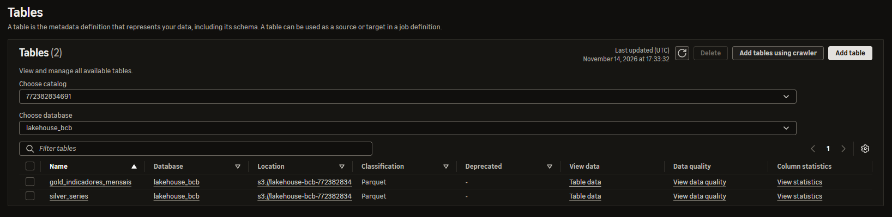
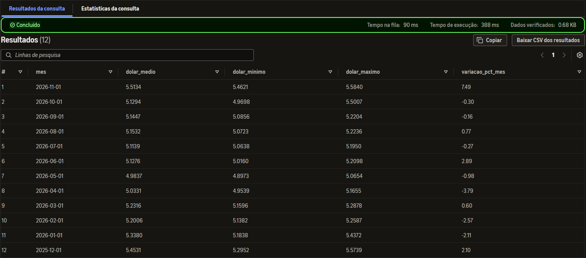
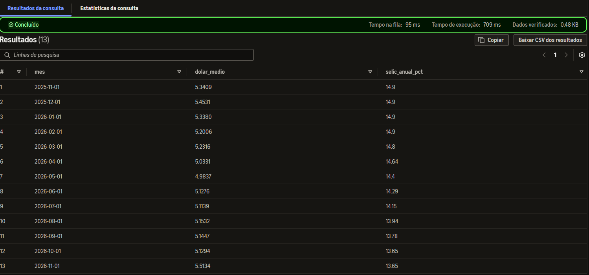
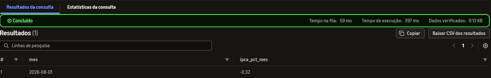
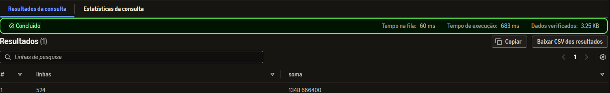

# Lakehouse serverless na AWS — Indicadores do Banco Central


Pipeline de dados que ingere **dólar, Selic e IPCA** da API pública do Banco Central,
organiza os dados em camadas **bronze → silver → gold** no S3 e disponibiliza tudo para
consulta em SQL no **Athena**. Toda a infraestrutura é criada com **Terraform**.

## Arquitetura



## Stack

| Ferramenta | Uso | Por que escolhi |
| --- | --- | --- |
| **AWS Lambda** | Ingestão da API | Serverless: paga só pelos segundos de execução |
| **Amazon S3** | Data lake (bronze, silver, gold) | Armazenamento barato e desacoplado do processamento |
| **AWS Glue (PySpark)** | Transformações | Spark gerenciado, com bookmarks para carga incremental |
| **Glue Data Catalog** | Metadados das tabelas | Permite consultar os arquivos do S3 como tabelas SQL |
| **Amazon Athena** | Consultas analíticas | SQL serverless, cobra por dado lido |
| **Terraform** | Infraestrutura como código | Reproduzível: `apply` cria tudo, `destroy` apaga tudo |
| **pytest + ruff** | Testes e lint | Lógica testada localmente, sem custo de nuvem |
| **GitHub Actions** | CI | Lint, testes e validação do Terraform a cada push |

## Camadas de dados

| Camada | Conteúdo | Formato | Particionamento |
| --- | --- | --- | --- |
| **Bronze** | Dado bruto da API + `serie` e `ingested_at` | JSON Lines | `serie` / período |
| **Silver** | Dado limpo, tipado (data, decimal) e deduplicado | Parquet (snappy) | `serie` / `ano` |
| **Gold** | Indicadores mensais: média, mínimo, máximo e variação % | Parquet (snappy) | `serie` |

## Decisões técnicas

- **Bronze em JSON, silver e gold em Parquet.** A bronze preserva o formato original da fonte
  para auditoria e reprocessamento. A conversão para Parquet colunar acontece na silver, onde
  os dados ganham tipos e particionamento.
- **Ingestão idempotente.** A chave do arquivo depende só do período buscado: reprocessar o
  mesmo período sobrescreve, sem duplicar.
- **Backfill parametrizado.** A Lambda aceita `data_inicio` e `data_fim` para carregar histórico.
- **Carga incremental com job bookmarks.** O job bronze → silver processa só arquivos novos.
- **Sem crawlers.** As tabelas são registradas pelo próprio job (`enableUpdateCatalog`),
  evitando o custo mínimo de 10 minutos por execução de crawler.
- **Valores em `decimal(18,6)`**, não `float`, para evitar erros de arredondamento em dado financeiro.
- **Deduplicação na gold com `ROW_NUMBER()`**, protegendo contra reprocessamentos.
- **Lógica separada da infraestrutura.** As regras ficam em `transforms.py` (funções puras),
  testadas localmente com PySpark e reaproveitadas pelo job do Glue.
- **Menor privilégio.** A Lambda só pode gravar em `bronze/`.
- **Custo controlado.** Jobs com 2 workers (o padrão é 10), agendamentos desligados por padrão
  e limite de 1 GB lido por consulta no workgroup do Athena.

## Qualidade de dados

O job bronze → silver **interrompe o pipeline** se alguma regra for violada:

1. Série desconhecida
2. Valor negativo em dólar ou Selic
3. Dólar fora da faixa de R$ 1 a R$ 20
4. Mais de um valor por série e data

**Caso real:** na primeira execução, o job foi barrado por "valor negativo". A investigação
mostrou que o **IPCA (série 433) é a variação percentual mensal da inflação** e pode ser
negativo em meses de **deflação** (agosto de 2026: −0,32%). A regra foi corrigida para valer
só para dólar e Selic, e dois testes foram adicionados para cobrir o caso.

## Resultados

- **524 registros** de nov/2025 a nov/2026 (dólar e Selic diários, IPCA mensal)
- **Carga incremental:** a carga completa levou **101 s**; as reexecuções sem dados novos levaram **74 s e 45 s** e não gravaram nenhum arquivo
- **Partition pruning no Athena:**

| Consulta | Linhas | Dados lidos |
| --- | --- | --- |
| Silver inteira | 524 | 3,25 KB |
| `WHERE serie = 'dolar'` | 256 | 1,91 KB (**−41%**) |

As consultas estão em [`sql/consultas.sql`](sql/consultas.sql).

## Evidências

| | |
| --- | --- |
| Camadas no S3 |  |
| Jobs do Glue |  |
| Carga incremental (bookmark) |  |
| Tabelas no catálogo |  |
| Dólar — últimos 12 meses |  |
| Dólar × Selic anualizada |  |
| Meses com deflação |  |
| Sem filtro de partição |  |
| Com filtro de partição |  |

## Custo

| Serviço | Custo estimado |
| --- | --- |
| Lambda, S3, Catalog, Athena | ~US$ 0,00 (volume em KB) |
| Glue | ~US$ 0,02 por execução (2 DPUs × ~100 s × US$ 0,44/DPU-hora) |

Custo total do projeto: **menos de US$ 1**. Ao final, `terraform destroy` remove todos os recursos.

## Como rodar

Pré-requisitos: conta AWS, AWS CLI, Terraform, Python 3.12 e Java 17 (para os testes).

```bash
# 1. Infraestrutura
cd infra
terraform init
terraform apply

# 2. Carga histórica (backfill)
aws lambda invoke --function-name bcb-ingestao \
  --cli-binary-format raw-in-base64-out \
  --payload '{"data_inicio":"2025-11-01","data_fim":"2026-11-11"}' saida.json

# 3. Transformações
aws glue start-job-run --job-name bcb-bronze-to-silver
aws glue start-job-run --job-name bcb-silver-to-gold   # após o anterior terminar

# 4. Consultas: Athena, workgroup "portfolio", database "lakehouse_bcb"

# 5. Remover tudo
terraform destroy
```

Testes locais:

```bash
pip install -r requirements-dev.txt
pytest -v
ruff check .
```

## Estrutura

```text
├── infra/            # Terraform (S3, Lambda, Glue, Athena, IAM)
├── src/
│   ├── ingestion/    # Lambda de ingestão
│   └── glue_jobs/    # Jobs do Glue + transforms.py (lógica testável)
├── tests/            # Testes com PySpark local
├── sql/              # Consultas do Athena
└── .github/workflows # CI
```

## Limitações e próximos passos

- **Mês corrente parcial:** a média do último mês considera só os dias já carregados.
- **Arquivos pequenos:** o Spark gera vários arquivos por partição. Em escala, usar `coalesce`
  ou compactação reduziria o número de arquivos lidos pelo Athena.
- Migrar silver e gold para **Apache Iceberg** (MERGE, time travel).
- Orquestrar o pipeline com **Airflow** (próximo projeto do portfólio).
- Usar **Glue Data Quality** para regras declarativas e histórico de qualidade.